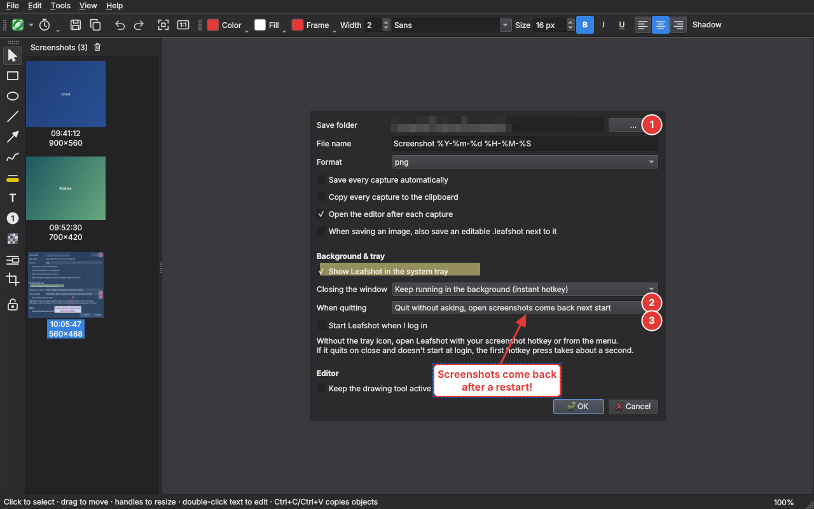
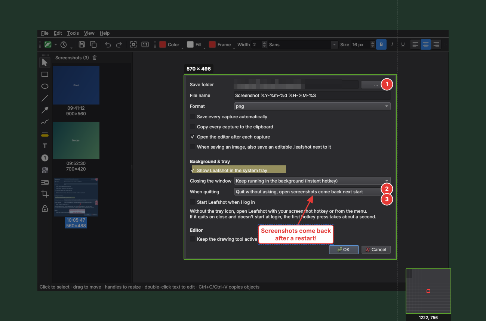

<p align="center"></p>

<h1 align="center">Leafshot</h1>

<p align="center"><b>A Greenshot-style screenshot and annotation tool for Linux Mint (Cinnamon, X11).</b><br>
Press Print, select, annotate, done. Every screenshot stays in one window, and every annotation stays editable.</p>



## Why Leafshot?

- **One window, many screenshots:** every Print press adds a tab to the session strip instead of opening a new window.
- **Annotations stay objects:** select, move, resize and restyle arrows, boxes and texts at any time. **Ctrl+C / Ctrl+V** copies annotations, even into another screenshot.
- **Editable text:** double-click to change it later. Pick any font, bold / italic / underline, left / center / right, fill and frame.
- **Tools:** rectangle, ellipse, line, arrow, freehand, highlighter (also on dark backgrounds), text, numbered steps, pixelate, **cover** (fills with the surrounding background so text disappears without a trace), crop, and an eyedropper.
- **Capture like Greenshot:** drag a region or click a window, with a magnifier for pixel-exact edges. Also active window, a single monitor, all monitors, repeat last region, and a **delay** with a countdown in the tray, for capturing open menus.
- **Nothing gets lost:** open screenshots survive quitting, reboots and crashes. Save editable `.leafshot` files and continue another day.
- **Fast:** stays in the background; a hotkey press is handed over in about 40 ms.



## Requirements

- Linux with an **X11** session (Linux Mint Cinnamon / MATE / XFCE default session). Wayland sessions are not supported yet: screenshots come out black.
- Python 3 and PyQt6 (`python3-pyqt6` on Debian / Ubuntu / Mint; the installer installs it if it's missing).
- The Print-key hotkeys are set up automatically on Cinnamon; on other desktops add a custom shortcut for `~/.local/bin/leafshot region`.

## Install

Download the latest release (or `git clone https://github.com/electricar/leafshot`), then:

```bash
cd leafshot
./install.sh
```

- If PyQt6 is missing, the installer runs `sudo apt install python3-pyqt6`.
- It copies the app to `~/.local/share/leafshot`, puts the `leafshot` command in `~/.local/bin`, and adds a menu entry and an autostart entry.
- Optionally it binds the Print keys. Cinnamon's own screenshot keys are saved, and `./uninstall.sh` restores them.

| Key | Action |
|---|---|
| Print | Drag a region, **or click a window**, or press Enter for the whole monitor |
| Alt+Print | Active window |
| Ctrl+Print | All monitors |
| Shift+Print | Repeat the last region |

To update, download the new version and run `./install.sh` again. Your open screenshots and settings are kept.

## Capturing

**Delay (to capture open menus):** click the ⏱ clock next to the capture button (or tray menu → Delay) and choose 1–10 seconds. It applies to every capture, including the Print key: press Print, open your context menu, and the screenshot is taken when the countdown ends. The tray icon counts down 3 → 2 → 1, and the tray menu has "Cancel delayed capture". Set it back to "No delay" when you're done. Tip: for menus, "all monitors", "current monitor" or "repeat last region" work best, because with a region capture your first click only closes the menu in the background.

The same actions are available from the command line: `leafshot region|window|full|screen|last|show|open FILE…|quit`, plus `--delay 3` for a delayed capture.

## Editor

**Tools:** V select · R rectangle · E ellipse · L line · A arrow · F freehand · H highlighter · T text · N numbered steps (1, 2, 3 …) · P pixelate · B cover (fills with the surrounding background color, so text disappears without a trace) · C crop

- Hold Shift while drawing for a straight line (45° steps) or a perfect square/circle.
- After drawing, Leafshot switches back to Select with the new object selected, so you can move or resize it right away.
- Press **Q** (or click the padlock under the tools) to lock the current tool so you can draw several objects in a row, for example numbered steps 1, 2, 3. The same option is in Settings.
- Text: pick any installed font from the dropdown (type to search; your 5 most recent fonts are at the top), make it bold, italic or underlined (B / I / U), align multi-line text left, center or right, and give the text box a frame (Frame color + Width for the thickness). If a `.leafshot` is opened on a PC without that font, a standard font is used; exported images always look right.
- Eyedropper: **I** picks the line/text color from the screenshot, **Shift+I** the fill color. Both are also in the Color and Fill menus.
- Width 0 = no outline, for example a plain filled box.
- Press Esc or right-click to go back to Select.

**Working with objects**
- Ctrl+C / Ctrl+V copy and paste, Ctrl+X cut, Ctrl+D duplicate, Del delete, Ctrl+A select all.
- Arrow keys nudge by 1 px (Shift: 10 px). Ctrl+Shift+↑/↓ bring to front / send to back.
- Changing color, width, font size and so on applies to everything selected. Each tool also remembers its own last style.
- If the clipboard holds an image, Ctrl+V pastes it as a movable object. If it holds text, Ctrl+V adds a text object.
- Everything can be undone (Ctrl+Z / Ctrl+Y).

**Files**
- Ctrl+S saves quickly to `~/Pictures/Screenshots`; the folder and name pattern can be changed in Settings.
- Ctrl+Shift+S save as · Ctrl+Shift+C copy image · Ctrl+W close tab.
- Ctrl+Shift+V pastes a clipboard image as a new tab. You can also drop image files onto the window.
- Drag a thumbnail from the left-hand strip straight into mail, a chat or the file manager.

**View:** Ctrl+wheel zoom · middle-drag to pan · Ctrl+0 fit · Ctrl+1 100%

**Clear the list:** the trash button next to "Screenshots (n)" above the thumbnails (or Ctrl+Shift+W, or File → Close all screenshots) closes every open screenshot. It asks once if any have unsaved annotations. Right-click a thumbnail for "Close all others".

**Duplicate:** Ctrl+Shift+D copies the screenshot to a new tab with the annotations still editable. Ctrl+Shift+F makes a flattened copy, with the annotations baked into the picture, so you can annotate on top of it. Both are also in the thumbnail right-click menu.

**Continue later**
- **Session:** open screenshots survive quitting, reboots and crashes (see Quitting below).
- **Editable files:** Ctrl+Alt+S saves a `.leafshot` file containing the screenshot plus all annotation objects. Open it with Ctrl+O, by dropping it on the window, or by double-clicking it in the file manager. In Settings you can also have a `.leafshot` saved automatically next to every saved image.
- ⚠️ **A `.leafshot` file contains the original screenshot**, so pixelated or covered areas can be un-hidden in it. To share a screenshot, send the PNG/JPG, never the `.leafshot`.

**Background & tray** (Settings)
- **Show in the system tray:** on/off. Without the icon Leafshot still runs in the background; open it with your screenshot hotkey or from the menu.
- **Closing the window:** keep running in the background (default, instant hotkey) or quit Leafshot.
- **Start at login:** on/off. The installer respects your choice.

**Quitting**
- Closing the window keeps Leafshot running unless you changed that in Settings.
- What **Ctrl+Q** (or Quit in the tray) does is set in Settings → "When quitting":
  - *Quit without asking, open screenshots come back next start* (default)
  - *Quit without asking, next start is empty*
  - *Ask what to do*: keep for next time / save unsaved as images and start fresh / discard
- **Ctrl+Shift+Q** ("Quit without saving") always quits immediately and throws everything away.
- Open screenshots are auto-saved in the background in every mode, so after a crash or power loss they always come back.

## Troubleshooting

- **Print does nothing:** check System Settings → Keyboard → Shortcuts → Custom shortcuts for the "Leafshot:" entries. You can also run `python3 ~/.local/share/leafshot/hotkeys.py install ~/.local/bin/leafshot` again.
- **Black screenshot:** you are probably in a Wayland session. Leafshot captures through X11, which is Mint's default session.
- **To see errors:** quit from the tray, then start `leafshot` from a terminal.

## Uninstall

`./uninstall.sh` removes the app and restores Cinnamon's screenshot keys. Your settings (`~/.config/leafshot`) and open screenshots (`~/.local/share/leafshot/session`) are kept.

## License

Leafshot is free software under the [GNU General Public License v3.0](LICENSE).
It is inspired by Greenshot but not affiliated with Greenshot or Linux Mint.
